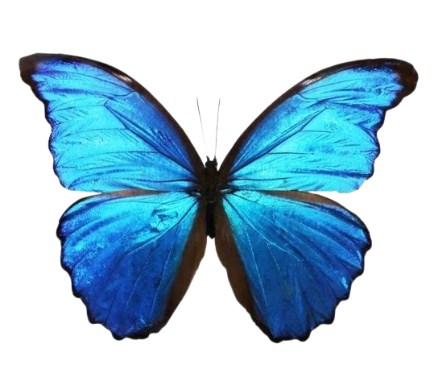
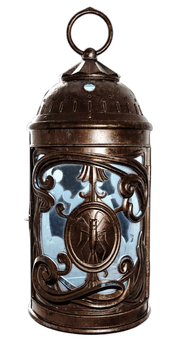
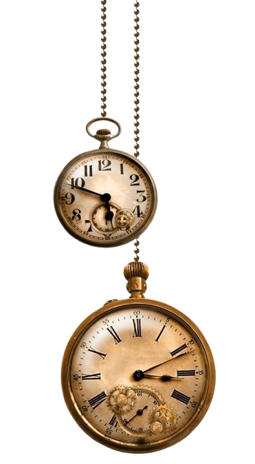
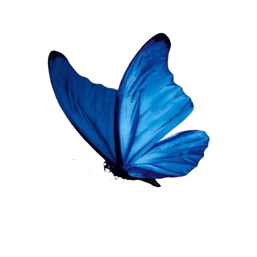
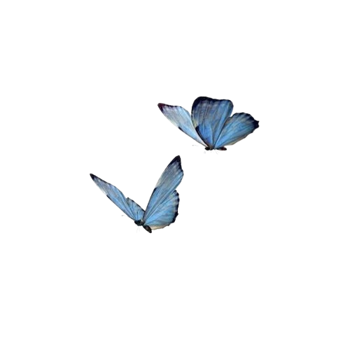

<div align="center">


<p>
	
	&nbsp;&nbsp;
	
	&nbsp;&nbsp;
	
	&nbsp;&nbsp;
	
	&nbsp;&nbsp;
	
</p>

<p><em>"There is no salvation for the weak."</em></p>

<p>
	
</p>

</div>


## Sobre mim


```yaml
nome:       Kauan Xavier Rangel Costa
curso:      Análise e Desenvolvimento de Sistemas
faculdade:  FATEC Cruzeiro
status:     Em busca de bugs para resolver
```

Desenvolvedor em formação, apaixonado por tecnologia e por mundos onde a linha entre fantasia e realidade é tênue como a chama de uma lamparina na névoa de Krat.

<br clear="right"/>


## Linguagens e ferramentas

<div align="center">


</div>


## Projetos 

<div align="center">

| Projeto | Tecnologia | Descrição |
|:-------:|:----------:|:---------:|
| [event-house](https://github.com/CARI0C4/event-house) | Java | Sistema de gerenciamento de eventos |
| [Organização Financeira](https://github.com/CARI0C4/Organiza-o_finc) | CSS/HTML | Controle de finanças pessoais |
| [trabaio](https://github.com/CARI0C4/trabaio) | HTML | Projeto acadêmico |

</div>


## Estatísticas

<div align="center">


</div>

<br/>

<div align="center">


</div>


<div align="center">



<em>"Even if your legs give out, crawl forward."</em>

<br/>


</div>


